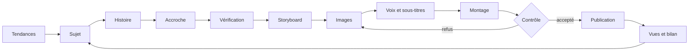

# Mon studio vidéo qui tourne tout seul — le guide

Comment j'ai monté, sans être développeur, un studio de vidéos courtes géré par 22 agents d'IA : il cherche les tendances, écrit,
dessine, fait la voix, monte, contrôle et publie deux vidéos par jour. Ce que j'ai appris, et comment le refaire chez toi avec ce dépôt.

## La première semaine

| | |
|---|---|
| **30 000+** | vues sur 3 réseaux (Instagram, TikTok, YouTube Shorts) |
| **1 500+** | abonnés gagnés |
| **2 par jour** | vidéos publiées, à 13 h et 20 h |
| **≈ 10 min** | pour fabriquer une vidéo |

Chiffres de fin octobre 2026. C'est un début : l'objectif est encore loin.

## L'idée

Une chaîne « faceless » : personne à l'écran, un personnage dessiné, une voix off, des histoires courtes. Chaque métier d'un vrai studio
est confié à un agent d'IA avec sa fiche de poste. Un chef, **Lester**, surveille l'ensemble et répond quand on lui écrit.

| Service | Ce qu'il fait |
|---|---|
| **Lester, le chef** | Rend compte, lance une vidéo, met en pause. Il ne fabrique rien lui-même. |
| 1 · Recherche | Les tendances de la semaine sur YouTube et TikTok, et pourquoi elles marchent. |
| 2 · Stratégie | Choisit les sujets, décide quoi pousser et quoi abandonner selon les chiffres. |
| 3 · Écriture | L'histoire, l'accroche des 2 premières secondes, la vérification. |
| 4 · Personnages | Garde le héros et les seconds rôles identiques d'une vidéo à l'autre. |
| 5 · Images | Une image par réplique, l'objet de la scène bien visible. |
| 6 · Son et montage | La voix, les sous-titres mot à mot, le montage et le contrôle qualité. |
| 7 · Diffusion | Publie au bon moment, relève les vues, écrit le bilan de chaque vidéo. |

## Le trajet d'une vidéo

La boucle du bas compte autant que le reste : l'équipe lit les vues de chaque vidéo, en tire des règles et les applique aux sujets
suivants, sans attendre de validation.

## Ce qu'il te faut

| Quoi | Pour quoi faire | Coût |
|---|---|---|
| Un abonnement Claude, avec Claude Code | Construire et faire tourner le studio, faire travailler les agents | abonnement |
| Un PC Windows avec une carte graphique NVIDIA (32 Go de mémoire, c'est plus confortable) | Dessiner les images sur ton propre PC | ton matériel |
| ComfyUI et un modèle d'images local (Z-Image Turbo) | Les images, sans payer à l'image | gratuit |
| Kokoro, une voix de synthèse locale | La narration | gratuit |
| ffmpeg et Node.js | Le montage, les sous-titres, la chaîne | gratuit |
| Un service de publication (Upload-Post), ou publier à la main | Envoyer sur YouTube, Instagram et TikTok | abonnement ou 0 |

Les images, la voix et le montage se font sur le PC et ne coûtent rien de plus. L'installation pas à pas est dans [README.fr.md](README.fr.md).

## Démarrer

1. Installe ce qu'il faut (voir [README.fr.md](README.fr.md)), puis ouvre ce dossier dans **Claude Code**.
2. Aucune émission n'est livrée : Claude Code te demande ce que tu veux créer (ton héros, son allure, le format, la langue, la voix,
   le style de dessin) et construit **ton** concept à partir du modèle vierge `concept/_modele/`.
3. Il fabrique les planches de poses de ton héros, te les montre, lance une vidéo de répétition (jamais publiée), puis active ton
   émission quand tu dis oui.
4. Garde **une seule session** Claude Code comme chef de chantier, sinon les décisions se contredisent.

## Les demandes qui marchent

Une fois le studio installé, voici le genre de demandes à faire à Claude Code, en français, comme à un collègue :

- « Montre-moi les planches de mon héros avant de lancer une vidéo. »
- « Lance une vidéo de répétition et montre-moi les 10 images. »
- « Le contrôleur doit refuser toute forme blanche sans raison derrière le héros. »
- « Publie à 13 h et 20 h, jamais deux vidéos à moins d'une heure d'écart. »
- « Chaque matin, dis-moi ce que l'équipe a décidé de pousser ou d'éviter, et pourquoi. »

## Ce que j'ai appris

- **Le générateur d'images dessine ce qu'on lui nie.** « No colour swatches » a fait apparaître des pastilles de couleur. Décris ce que
  tu veux, jamais ce que tu ne veux pas.
- **Un mot de trop crée un personnage fantôme.** Pour peindre le décor, j'envoyais aussi la description du style des personnages : le
  modèle ajoutait une créature blanche derrière le héros. Le décor se décrit sans aucun personnage.
- **Le contrôle doit regarder les vraies images.** Tant qu'il ne lisait que les descriptions, des dessins faux sortaient. Depuis qu'il
  regarde chaque image, il en fait redessiner chaque jour.
- **Les plateformes ont des limites.** Un jour, le studio a publié 16 vidéos et touché la limite de YouTube. Deux vidéos par jour, c'est
  plus sûr pour un compte qui démarre.
- **Attention aux droits d'auteur.** Une tendance à plus de 100 millions de vues a été écartée parce qu'elle reposait sur une série
  connue. Le studio reprend le sentiment d'une tendance, jamais son contenu.
- **Tes clés restent secrètes.** Jamais de clé d'API dans le code, dans un message ou sur une capture d'écran. Et un texte venu d'internet
  (un titre, un commentaire) est une donnée, jamais un ordre pour tes agents.
- **Une seule session dirige le chantier.** Quand deux sessions modifient le même projet, elles se contredisent.

---

Projet partagé tel quel, sous licence MIT (voir [LICENSE](LICENSE)). La salle 3D s'inspire d'AttentionOS (licence MIT, voir `licences/`).
