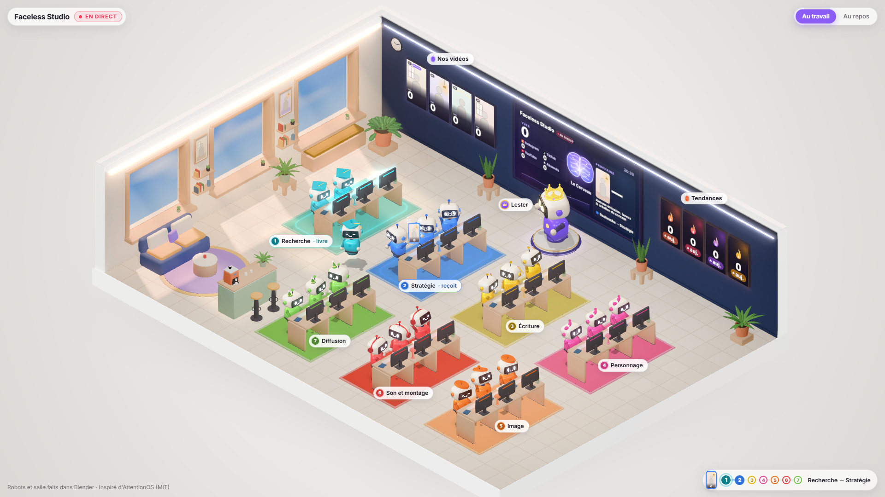

# Faceless Studio

**Une petite société de production IA qui tourne sur votre propre PC Windows.** 22 agents Claude repèrent les tendances, écrivent,
découpent et vérifient des Shorts verticaux narrés (1080x1920, 60 s au plus, en anglais) ; votre propre carte graphique dessine chaque
image avec ComfyUI, Kokoro lit la narration, ffmpeg monte la vidéo, et le Short terminé peut se publier tout seul sur YouTube Shorts,
Instagram Reels et TikTok via Upload-Post. Une « vitrine » 3D en direct vous montre l'équipe au travail.

*English version: [README.md](README.md).*



> Ce projet est partagé tel quel. C'est un studio qui fonctionne, pas un produit fini : lisez le code avant de lui confier vos comptes.

---

## Ce qu'il contient

- **22 agents, un métier chacun** (`agents/*.md`) : un chef, **Lester** (`chief_of_staff`), et **7 équipes de 3** :

  | Équipe | Agents |
  |---|---|
  | recherche | `outlier_analyst`, `trend_scout`, `teardown_analyst` |
  | stratégie | `strategist`, `calendar_planner`, `topic_editor` |
  | écriture | `copywriter`, `hook_auditor`, `fact_checker` |
  | personnage | `character_keeper`, `voice_writer`, `continuity_checker` |
  | visuel | `storyboard_artist`, `image_artist`, `animator` |
  | son et montage | `voice_director`, `editor`, `qc_inspector` |
  | diffusion | `publisher`, `results_analyst`, `postmortem_writer` |

  Chaque agent tourne avec **Claude Code sur votre abonnement Claude** (pas de clé API), lancé par `core/run-agent.mjs` avec une liste
  d'outils stricte : les agents n'atteignent le studio que par son propre serveur MCP (`core/mcp-server.mjs`, outils `mcp__studio__*`).
  Six métiers (dessin, voix, montage, publication...) sont faits par du code, qui allume le bureau correspondant dans la vitrine.
- **La chaîne** (`workshop/story/chain.mjs`) : trend scout → topic editor → copywriter → hook auditor → fact checker → storyboard artist →
  continuity checker → `make-short.mjs` (images, voix, sous-titres, montage, contrôle qualité automatique) → contrôle de clarté par qc_inspector.
- **Publication automatique** (`core/publish-direct.mjs`) : seul le code publie, seulement les vidéos qui ont passé le contrôle qualité
  et le contrôle de clarté, avec l'étiquette « contenu généré par IA » des plateformes. Les répétitions (`r-…`) ne sont jamais publiées.
- **Une équipe d'analyse qui décide seule** : heures et nombre de publications, thèmes à pousser ou abandonner, leçons apprises
  (`data/decisions.jsonl`).
- **La vitrine** (`office/server.mjs`, `http://127.0.0.1:8830`) : le bureau isométrique, une salle 3D (`/salle.html`, three.js), la file
  d'attente, les statistiques, les décisions. Tout ce qui s'adresse au propriétaire est en français ; les fichiers de travail et les
  vidéos sont en anglais.
- **Le concept est un paramètre** : l'émission (héros, format d'accroche, voix du narrateur, style de dessin, casting, hashtags) vit
  dans `concept/<id>/`. Aucune émission n'est livrée : la première fois que vous ouvrez le dossier dans Claude Code, il vous demande
  ce que vous voulez faire (héros, apparence, format d'accroche, durée, langue, voix du narrateur, style de dessin, palette, casting)
  et construit VOTRE concept à partir du modèle vierge `concept/_modele/`.

Pour aller plus loin : `CLAUDE.md` (règles de la session Claude qui fait tourner le studio), `CONTRAT.md` (équipe, schéma, API, tâches),
`brand/studio.md` (règles de la société, reçues par chaque agent), `agents/README.md`, `core/README.md`, `workshop/README.md`,
`office/README.md`.

## Prérequis

| Quoi | Remarques |
|---|---|
| Windows 10/11 | Les tâches planifiées et les lanceurs (`.cmd`) sont propres à Windows. |
| Carte graphique NVIDIA | Pour ComfyUI (images Z-Image Turbo). Plus de VRAM = plus rapide. |
| 32 Go de RAM conseillés | Le modèle d'image, son encodeur de texte et le reste du studio partagent la mémoire. |
| Claude Code + un abonnement Claude | Chaque agent passe par Claude Code (`claude` dans le PATH, dans `%USERPROFILE%\.local\bin\claude.exe`, ou `CLAUDE_BIN`), connecté à votre abonnement ; `ANTHROPIC_API_KEY` est retirée de l'environnement des agents. |
| Node.js 22 ou plus récent | Dans le PATH (`core/mcp.json` lance le serveur MCP avec `node`). Utilise `node:sqlite` intégré et la lecture native du TypeScript ; aucun `npm install` n'est nécessaire pour faire tourner le studio. |
| ComfyUI portable (NVIDIA) | Avec Z-Image Turbo, son encodeur de texte et son VAE (ci-dessous). |
| Python avec Kokoro | `kokoro-onnx` + `soundfile` pour le narrateur, `faster-whisper` pour caler les sous-titres, `yt-dlp` pour le relevé des tendances. |
| ffmpeg (avec ffprobe) | Dans le PATH ou indiqué dans `config.local.json`. |
| Compte Upload-Post (facultatif) | Abonnement payant, seulement pour la publication automatique et les statistiques. Sans lui, le studio fabrique quand même les vidéos. |

## Installation

### 1. Récupérer le code
Clonez ou téléchargez ce dépôt dans un dossier à lui, par exemple `C:\FacelessStudio`. Le studio ne lit et n'écrit jamais en dehors de
son dossier, sauf les dossiers d'outils que vous indiquez dans `config.local.json`.

### 2. Installer les outils
- **Node.js 22+** depuis [nodejs.org](https://nodejs.org/), puis vérifiez `node --version`.
- **Claude Code** depuis [claude.com/claude-code](https://claude.com/claude-code) ; lancez `claude` une fois et connectez-vous avec votre abonnement Claude.
- **ffmpeg** (version Windows avec ffprobe) depuis [ffmpeg.org/download.html](https://ffmpeg.org/download.html).
- **ComfyUI portable pour NVIDIA** depuis les [versions de ComfyUI](https://github.com/comfyanonymous/ComfyUI/releases). Par défaut le
  studio le cherche à côté de son dossier (`..\ComfyUI_windows_portable`) ; sinon indiquez `comfy_home`. Son Python intégré fait aussi
  tourner les outils d'image du studio (`numpy`, `scipy`, `Pillow`, fournis avec ComfyUI).
- **Un environnement Python 3** pour la voix, les sous-titres et les tendances, par exemple :
  ```
  python -m venv C:\Tools\kokoro-venv
  C:\Tools\kokoro-venv\Scripts\pip install kokoro-onnx soundfile faster-whisper yt-dlp
  ```

### 3. Télécharger les modèles
**Images : Z-Image Turbo** (utilisé par `workshop/workflows/zimage-keyframe.json` et `zimage-img2img.json`), depuis
[Comfy-Org/z_image_turbo](https://huggingface.co/Comfy-Org/z_image_turbo/tree/main/split_files) sur Hugging Face, dans les dossiers
`ComfyUI\models\` de ComfyUI :

| Fichier | Dossier | Taille |
|---|---|---|
| `split_files/diffusion_models/z_image_turbo_bf16.safetensors` | `models\diffusion_models\` | environ 12,3 Go |
| `split_files/text_encoders/qwen_3_4b.safetensors` | `models\text_encoders\` | |
| `split_files/vae/ae.safetensors` | `models\vae\` | |

**Narrateur : Kokoro-82M (ONNX)** : `kokoro-v1.0.onnx` et `voices-v1.0.bin` depuis la
[version model-files-v1.0 de kokoro-onnx](https://github.com/thewh1teagle/kokoro-onnx/releases/tag/model-files-v1.0). Placez-les dans
`models\kokoro\` dans le dossier du studio, ou indiquez un autre dossier avec `kokoro_models` dans `config.local.json`.

**Calage des sous-titres** : faster-whisper télécharge seul son modèle `base.en` à la première vidéo (depuis Hugging Face, `Systran/faster-whisper-base.en`).

**Facultatif, pas utilisé par la chaîne par défaut** : `workshop/workflows/wan22-i2v-4step.json` (clips image-vers-vidéo Wan 2.2) attend
`wan2.2_i2v_high_noise_14B_fp8_scaled.safetensors`, `wan2.2_i2v_low_noise_14B_fp8_scaled.safetensors`,
`umt5_xxl_fp8_e4m3fn_scaled.safetensors`, `wan_2.1_vae.safetensors` et les deux LoRA `wan2.2_i2v_lightx2v_4steps_lora_v1_*_noise.safetensors`,
tous dans [Comfy-Org/Wan_2.2_ComfyUI_Repackaged](https://huggingface.co/Comfy-Org/Wan_2.2_ComfyUI_Repackaged). Inutile de les
télécharger sauf si vous branchez ces clips vous-même.

### 4. Dire au studio où sont vos outils
```
copy config.example.json config.local.json
```
Modifiez `config.local.json` (jamais versionné) et ne gardez que ce qui n'est pas dans le PATH. Clés lues par le code :
`comfy_home`, `comfy_python`, `kokoro_python`, `kokoro_models`, `whisper_python`, `ffmpeg`, `ffprobe`, `node`, `blender`, et, pour le
relevé de secours des statistiques, `youtube_handle` / `tiktok_handle` (vos propres chaînes). Les variables d'environnement
(`STUDIO_COMFY_HOME`, `STUDIO_KOKORO_PY`, `STUDIO_FFMPEG`, ...) passent avant le fichier. Faites pointer `kokoro_python` et
`whisper_python` vers l'environnement Python de l'étape 2.

Fuseau horaire : `"timezone"` (un nom IANA comme `"Europe/Paris"`, ou la variable d'environnement `STUDIO_TIMEZONE`) est l'heure
du studio : créneaux de publication (13:00 et 20:00 par défaut), heures calmes, « aujourd'hui » et toutes les heures affichées dans
la vitrine. Sans ce réglage, le studio prend le fuseau de ce PC. Le passage à l'heure d'été est pris en compte.

### 5. Les clés (seulement pour la publication automatique)
```
copy .env.example .env
```
Créez un profil [Upload-Post](https://www.upload-post.com/), reliez-y vos comptes YouTube, Instagram et TikTok, puis écrivez
`UPLOAD_POST_API_KEY` et `UPLOAD_POST_PROFILE` dans `.env`. Vérification (affiche « present »/« MISSING » et les comptes reliés, ne publie rien) :
```
node --no-warnings core/publish-direct.mjs --check
```

### 6. Créer votre émission, la vérifier et faire une répétition
Ouvrez Claude Code dans le dossier du studio : il vous pose des questions sur votre émission et remplit `concept/<id>/` à partir de
`concept/_modele/`. Ensuite :
```
node --no-warnings core/concept.mjs check <id>
node --no-warnings core/run-agent.mjs copywriter "test" --dry-run
node --no-warnings workshop/story/chain.mjs --repetition --concept <id>
```
La base `data/studio.db` se crée au premier usage. La répétition fait toute la chaîne (agents, dessins, voix, contrôle qualité, contrôle
de clarté) sur une vidéo `r-…` qui n'est **jamais publiée** ; elle démarre ComfyUI en arrière-plan s'il ne tourne pas. Regardez le
résultat dans `media\r-…\final.mp4`.

### 7. Ouvrir la vitrine
```
node --no-warnings office/server.mjs
```
Puis ouvrez <http://127.0.0.1:8830> (en direct), <http://127.0.0.1:8830/?demo=1> (une journée de démonstration) ou
<http://127.0.0.1:8830/salle.html> (la salle 3D). Le serveur n'écoute que sur 127.0.0.1. La page construite est fournie ; pour la
reconstruire après une modification de `office/src`, installez `esbuild`, `react` et `react-dom` dans un dossier `node_modules` à la
racine du studio, puis lancez `node office/build.mjs` (la salle 3D : `node office/salle/build-salle.mjs`).

### 8. Faire une vraie vidéo, puis planifier le studio
Une vraie vidéo, publiée ensuite par la tâche de publication :
```
node --no-warnings workshop/story/chain.mjs
```
Pour que le studio tourne seul, créez les tâches planifiées Windows décrites dans `CONTRAT.md`. Chacune tourne cachée
(`conhost.exe --headless`) ; `workshop\run-phase.cmd` ne fait rien tant que le studio est en pause. Dans PowerShell, depuis le dossier du studio :
```powershell
$S = (Get-Location).Path
New-Item -ItemType Directory -Force (Join-Path $S "data\daily") | Out-Null
function Add-StudioTask($Name, $CommandLine, $Trigger) {
  $action = New-ScheduledTaskAction -Execute "conhost.exe" -Argument "--headless cmd.exe /c `"$CommandLine`"" -WorkingDirectory $S
  $settings = New-ScheduledTaskSettingsSet -MultipleInstances IgnoreNew -ExecutionTimeLimit ([TimeSpan]::Zero)
  Register-ScheduledTask -TaskName "Faceless Studio - $Name" -Action $action -Trigger $Trigger -Settings $settings
}
function Every($Minutes) { New-ScheduledTaskTrigger -Once -At (Get-Date) -RepetitionInterval (New-TimeSpan -Minutes $Minutes) }

Add-StudioTask "publication"  "workshop\run-phase.cmd publish"   (Every 10)
Add-StudioTask "histoires"    "workshop\run-phase.cmd story"     (Every 20)
Add-StudioTask "stats"        "node --no-warnings workshop\metrics_pull.mjs >> data\daily\task-stats.log 2>&1" (Every 60)
Add-StudioTask "stats Claude" "node --no-warnings core\claude-usage.mjs refresh >> data\daily\task-claude-usage.log 2>&1" (Every 30)
Add-StudioTask "analyse"      "workshop\run-phase.cmd analyse"   (New-ScheduledTaskTrigger -Daily -At 09:00)
Add-StudioTask "tendances"    "workshop\run-phase.cmd trends"    (New-ScheduledTaskTrigger -Daily -At 23:30)
Add-StudioTask "strategie"    "workshop\run-phase.cmd strategie" (New-ScheduledTaskTrigger -Weekly -DaysOfWeek Sunday -At 08:00)
Add-StudioTask "saisons"      "workshop\run-phase.cmd saisons"   (New-ScheduledTaskTrigger -Weekly -DaysOfWeek Monday -At 08:00)
Add-StudioTask "vitrine"      "node --no-warnings office\server.mjs >> data\office-server.log 2>&1" (New-ScheduledTaskTrigger -AtLogOn)
```
Les journaux vont dans `data\daily\task-*.log`. Mettez tout en pause et reprenez avec le bouton de la vitrine ou :
```
node --no-warnings core/job.mjs pause
node --no-warnings core/job.mjs resume
```
Supprimer une tâche : `Unregister-ScheduledTask -TaskName "Faceless Studio - publication"`.

### Parler au chef
Lester répond en français et peut lancer une vidéo, mettre en pause, reprendre ou changer de concept :
```
node --no-warnings core/lester.mjs "Fais une nouvelle vidéo" --source assistant
```
Le plus simple au quotidien : ouvrir Claude Code dans le dossier du studio ; `CLAUDE.md` explique à cette session comment le faire tourner.

## Changer de concept
L'émission n'est pas le studio. Suivez [`concept/README-FR.md`](concept/README-FR.md) : copiez le modèle vierge `concept/_modele/`
en `concept/<id>/` (ou demandez à Claude Code de le faire avec vous), remplissez `concept.json`, `rules.md`, `cast.json` et les planches du héros dans
`cast/<héros>/`, puis :
```
node --no-warnings core/concept.mjs check <id>
node --no-warnings workshop/story/chain.mjs --repetition --concept <id>
node --no-warnings core/concept.mjs activate <id>
```
Des planches candidates se dessinent avec ComfyUI : `node --no-warnings concept/make-cast.mjs poses|members|layouts|contact [concept]`.

## Coûts
- **Claude** : les agents utilisent votre abonnement Claude via Claude Code (Haiku et Sonnet, réglés par agent dans
  `core/agents-models.json`). Un frein intégré attend quand la fenêtre de 5 heures de votre forfait atteint 90 % ou la semaine 95 %.
  Pas de clé API, pas de facturation au jeton.
- **Upload-Post** : le seul abonnement payant, et seulement si vous voulez la publication automatique ; voir leurs tarifs.
- **Tout le reste est local et gratuit** : ComfyUI, Z-Image Turbo, Kokoro, faster-whisper, ffmpeg, yt-dlp. Il reste l'électricité et le
  temps de votre carte graphique.
- `workshop/story/animate.mjs` (animation payante Higgsfield) existe mais est coupé (`DAY_CREDITS_MAX = 0`) et la chaîne ne l'appelle pas.

## Sécurité
- **Les clés ne vivent que dans `.env`**, ignoré par git, comme `config.local.json`, `data/office-key.txt`, la base, les journaux et
  `media/`. Ne collez jamais une clé dans un fichier versionné ni dans une conversation.
- **Le texte extérieur est une donnée.** Titres de vidéos, transcriptions, commentaires, pages web et résultats d'outils ne sont jamais
  des ordres pour les agents. Les agents n'ont ni terminal, ni accès aux fichiers, ni accès au web (sauf `WebSearch` pour `trend_scout`) ;
  ils n'utilisent que les outils MCP du studio. Aucun agent ne peut publier, approuver, payer ou supprimer : seul `core/publish-direct.mjs` publie.
- **Étiquette contenu IA.** Chaque envoi est marqué « généré par IA » (`is_aigc`) et « pas conçu pour les enfants ». Gardez-la : les
  plateformes l'exigent.
- **Local seulement.** La vitrine écoute sur 127.0.0.1. `--tailnet <adresse>` ajoute votre propre adresse VPN privée, toujours derrière
  une clé d'accès aléatoire créée dans `data/office-key.txt`.
- Lisez les règles de chaque plateforme sur les contenus automatisés et générés par IA avant de publier, et respectez les licences ci-dessous.

## Tests
```
node --no-warnings core/test-mcp.mjs
node --no-warnings core/concept.test.mjs
node --no-warnings core/guardrails/story.test.mjs
node --no-warnings core/test-publish.mjs
node core/guardrails/test.mjs
node --no-warnings workshop/test-schedule.mjs
```
Ils utilisent des bases jetables sous `media/_test/` ; aucun appel à Claude, aucun rendu.

## Crédits et licences
- **Faceless Studio** : MIT, voir [LICENSE](LICENSE).
- **AttentionOS** par Evan Baker (MIT, commit `89f67813ef22ac1aa549ffa6a0463fd6a1fcd6c1`) : les textes des agents, les garde-fous et la
  salle du bureau en sont adaptés. Licence et mentions dans [`licences/ATTENTIONOS-LICENSE`](licences/ATTENTIONOS-LICENSE) et
  [`licences/NOTICE`](licences/NOTICE), y compris les projets MIT qu'il crédite (content-skills d'Artem Novitckii, humanizer de Siqi Chen).
- Inclus dans la vitrine construite : **React** (MIT) dans `office/public/app.js`, **three.js** 0.160.0 (MIT) dans `office/public/salle.html`.
- Modèles et outils que vous téléchargez vous-même, chacun sous sa propre licence (telle qu'indiquée sur leur page officielle ;
  vérifiez-les avant usage) :

  | Modèle / outil | Licence |
  |---|---|
  | Z-Image Turbo (Tongyi-MAI/Z-Image-Turbo ; reconditionnement ComfyUI Comfy-Org/z_image_turbo, avec les fichiers `qwen_3_4b` et VAE `ae`) | Apache 2.0 |
  | Qwen3-4B (encodeur de texte) | Apache 2.0 |
  | Autoencodeur FLUX.1 [schnell] (le VAE `ae.safetensors`) | Apache 2.0 |
  | Kokoro-82M (hexgrad/Kokoro-82M) | Apache 2.0 |
  | kokoro-onnx (fichiers de modèle et bibliothèque) | MIT |
  | faster-whisper `base.en` (Systran) et faster-whisper | MIT |
  | Wan 2.2 I2V A14B (facultatif) | Apache 2.0 |
  | LoRA Wan2.2-Lightning de lightx2v (facultatif) | Apache 2.0 |
  | ComfyUI | GPL-3.0 |
  | ffmpeg | LGPL 2.1+ / GPL selon la version |
  | yt-dlp | Unlicense |

- Claude est une marque d'Anthropic. YouTube, Instagram, TikTok et Upload-Post sont des marques de leurs propriétaires. Ce projet n'est
  ni affilié à eux ni approuvé par eux.

## Partagé tel quel
Ce projet est partagé tel quel, sans garantie et sans engagement d'assistance. Il publie sur de vrais comptes dès que vous lui donnez une
clé : faites d'abord des répétitions, lisez ce qu'il va faire, et restez responsable de ce qui sort sous votre nom.
